# Decentraland UI Component Kit 🦆

`@stom66/dcl-ui-component-kit` (aka **DUCK**) is a reusable UI toolkit for Decentraland SDK7.

[](https://decentraland.org/jump?realm=duckdemo.dcl.eth)

## Human? Here, watch this

[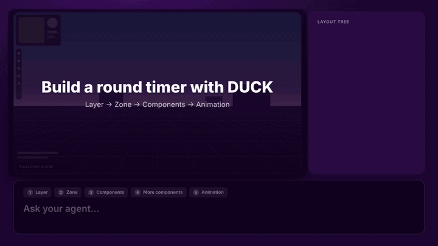](docs/media/duck-round-timer.mp4)

**Good-looking Decentraland UI without hand-tuning flexbox.** DUCK gives you ready-made HUDs, buttons, progress bars, toasts and animations that look like Decentraland out of the box and re-skin with your own art. Point your AI agent at this repo and it can build the UI for you. The video above shows the whole pattern: add a layer, pick a zone, add components, animate.

---

## Get started

Ask your AI. Point your agent at this repository (or `@stom66/dcl-ui-component-kit` on npm) and tell it to install the kit into your scene.

```text
Install @stom66/dcl-ui-component-kit into this Decentraland SDK7 scene.
Copy stock UI assets, scaffold a custom theme, wire SetupUiComponentKit, and follow the package README.
```

Prefer to do it yourself? **[docs/manual-install.md](docs/manual-install.md)**.

---

## Contents

- [Docs](#docs)
- [Making your own theme](#making-your-own-theme)
- [Building blocks](#building-blocks)
- [Components](#components)
  - [Layers and zones](#layers-and-zones)
    - [Layer](#layer)
    - [Zone](#zone)
    - [ZoneRoot](#zoneroot)
  - [Columns and rows](#columns-and-rows)
    - [Row](#row)
    - [RowReverse](#rowreverse)
    - [Column](#column)
    - [ColumnReverse](#columnreverse)
    - [Grid](#grid)
  - [Backgrounds and dividers](#backgrounds-and-dividers)
    - [Background](#background)
    - [BackgroundGradient](#backgroundgradient)
    - [Divider](#divider)
  - [Typography](#typography)
    - [H1 – H6](#h1--h6)
    - [SectionHeader](#sectionheader)
    - [Text](#text)
    - [Code](#code)
    - [Label](#label)
  - [Buttons and controls](#buttons-and-controls)
    - [ButtonText](#buttontext)
    - [ButtonImage](#buttonimage)
    - [ButtonImageClose](#buttonimageclose)
    - [Toggle](#toggle)
  - [Icons](#icons)
    - [Icon](#icon)
    - [SpriteIcon](#spriteicon)
    - [AvatarIcon](#avataricon)
    - [FontAwesome](#fontawesome)
    - [GameIcon](#gameicon)
  - [Progress bars](#progress-bars)
    - [ProgressBar](#progressbar)
    - [ProgressBarImage](#progressbarimage)
    - [ProgressBarRadial](#progressbarradial)
  - [Animations](#animations)
    - [Bounce](#bounce)
    - [FlashBorder](#flashborder)
    - [FlashColor](#flashcolor)
    - [Pulse](#pulse)
    - [Shake](#shake)
    - [Spinner](#spinner)
    - [Wiggle](#wiggle)
  - [Notifications](#notifications)
    - [ToastHostLayer](#toasthostlayer)
- [Example layouts](#example-layouts)
  - [Scoreboard / leaderboard](#scoreboard--leaderboard)
  - [Game status / round timer](#game-status--round-timer)
- [License & credits](#license--credits)
- [This repo as a demo scene](#this-repo-as-a-demo-scene)
- [Agent guidance](#agent-guidance)

---

## Docs

Guides live under [`docs/`](docs/).

### Setup

| Guide | Contents |
| --- | --- |
| [docs/manual-install.md](docs/manual-install.md) | npm install, `copy-assets`, theme scaffold, wiring |
| [docs/upgrade-caveats.md](docs/upgrade-caveats.md) | Breaking / behavioural changes between versions |

### Use

| Guide | Contents |
| --- | --- |
| [docs/layers-and-zones.md](docs/layers-and-zones.md) | Layer / Zone / `inset`, hideable popups, toasts |
| [docs/themes.md](docs/themes.md) | Affinity template, `init-theme`, agent wiring |
| [docs/custom-textures.md](docs/custom-textures.md) | Atlases, UV helpers (1-based) |
| [docs/components.md](docs/components.md) | Component reference with options tables |
| [docs/licensing.md](docs/licensing.md) | MIT package license + credits / attributions |
| [docs/media](docs/media/README.md) | Showcase GIF / media notes |

## Making your own theme

You do not need a custom theme to start — defaults look like Decentraland out of the box. When you want your own art:

- Install [Affinity](https://affinity.studio/) (free from Canva), get the Affinity template ([`assets/images/ui-component-kit/src/duck-assets.af`](https://github.com/stom66/dcl-ui-component-kit/blob/main/assets/images/ui-component-kit/src/duck-assets.af)) and customize buttons / progress bars / icons / etc. Connect Affinity to your agent over MCP and it can set up artboards and export PNGs for you — just ask it to walk you through the setup.
- Export PNGs into the theme folder the CLI scaffolds (`assets/images/themes/<name>/`) — never into stock `assets/images/ui-component-kit/`.
- Tell your agent to wire those files into the theme. Full walkthrough: [docs/themes.md](docs/themes.md).

## Building blocks

| Piece | Role |
| --- | --- |
| **Layer** | Show/hide group for a collection of UI (HUD, popup, menu). One layer = one zone. |
| **Zone** | Preset slot (`Top`, `BottomRight`, `Default`, …) via `zone: ZoneType.*` or `<Zone type={…}>`. |
| **Layout** | `Row` / `RowReverse`, `Column` / `ColumnReverse`, `Background`, `BackgroundGradient`, `Divider`, `Label`. |
| **Components** | Buttons, progress bars, text, icons, toggle, spinners / motion, toasts. |
| **Theme** | Colours / type / sizing. Override via `SetupUiComponentKit({ theme })` — never fork the defaults in place. |

# Components

<!-- Screenshots: save isolated captures under docs/media/components/ using the filenames below. -->

The examples assume the kit components, `Color4`, referenced atlases, and app callbacks are already in scope. `fullKitShorthands` shows the shared layout and visual shorthands accepted by components based on `KitEntityProps`; component-specific options are shown in each full example. Use only the shared options supported by the component's props.

<details>
<summary><b>Shared shorthand objects</b> (<code>fullKitShorthands</code>, <code>fullTextShorthands</code>)</summary>

```tsx
const fullKitShorthands = {
 backgroundColor : Color4.create(0.12, 0.16, 0.24, 1),
 borderColor     : Color4.create(0.4, 0.5, 0.7, 1),
 borderRadius    : 8,
 borderWidth     : 2,
 aspectRatio     : 2,
 width           : 320,
 height          : undefined,
 display         : 'flex',     // 'flex' | 'none'
 flex            : 1,
 justifyContent  : 'center',   // 'flex-start' | 'center' | 'flex-end' | 'space-between' | 'space-around' | 'space-evenly'
 positionType    : 'relative', // 'relative' | 'absolute'
 alignItems      : 'center',   // 'auto' | 'flex-start' | 'center' | 'flex-end' | 'stretch' | 'baseline' | 'space-between' | 'space-around'
 alignSelf       : 'stretch',  // 'auto' | 'flex-start' | 'center' | 'flex-end' | 'stretch' | 'baseline' | 'space-between' | 'space-around'
 alignContent    : 'center',   // 'auto' | 'flex-start' | 'center' | 'flex-end' | 'stretch' | 'baseline' | 'space-between' | 'space-around'
 position        : { top: 0, left: 0 },
 padding         : { top: 8, right: 12, bottom: 8, left: 12 },
 margin          : { top: 4, right: 4, bottom: 4, left: 4 },
 minWidth        : 64,
 maxWidth        : 480,
 minHeight       : 32,
 maxHeight       : 240,
 flexWrap        : 'wrap',     // 'wrap' | 'nowrap' | 'wrap-reverse'
 flexBasis       : 0,
 flexGrow        : 1,
 flexShrink      : 0,
 overflow        : 'hidden',   // 'hidden' | 'scroll' | 'visible'
 pointerFilter   : 'block',    // 'block' | 'none'
 opacity         : 1,
 zIndex          : 1,
}

const fullTextShorthands = {
 value     : 'Example text',
 fontColor : Color4.White(),
 fontSize  : 18,
 font      : 'sans-serif',     // 'sans-serif' | 'serif' | 'monospace'
 fontSrc   : 'assets/fonts/Display.ttf',
 textAlign : 'middle-left',    // 'top-left' | 'top-center' | 'top-right' | 'middle-left' | 'middle-center' | 'middle-right' | 'bottom-left' | 'bottom-center' | 'bottom-right'
 textWrap  : 'wrap',           // 'wrap' | 'nowrap'
}
```

</details>

## Layers and zones

### Layer

Groups UI in a zone and provides show, hide, and toggle behaviour.

**Minimum usage**

```tsx
class HudLayer extends Layer {
 constructor() {
  super({ id: "hud" })
 }

 protected body() {
  return <Zone type={ZoneType.Top}><Text value="Score: 0" /></Zone>
 }
}
```

<details>
<summary><b>Full shorthand usage</b></summary>

```tsx
class HudLayer extends Layer {
 constructor() {
  super({
   id              : 'hud',
   zone            : ZoneType.Top, // any ZoneType.* (Top, TopLeft, BottomRight, Default, FullScreen, …)
   inset           : 'device',     // 'none' | 'device' | 'interactable'
   canBeHidden     : true,
   startHidden     : false,
   showCloseButton : true,
   showFrom        : 'top',        // 'top' | 'bottom' | 'left' | 'right'
   hideTo          : 'top',        // 'top' | 'bottom' | 'left' | 'right'
   zIndex          : 10,
  })
 }

 protected body() {
  return <Zone type={ZoneType.Top}><Text value="Score: 0" /></Zone>
 }
}
```

</details>

---

### Zone

Positions UI in one of the kit's preset screen areas.

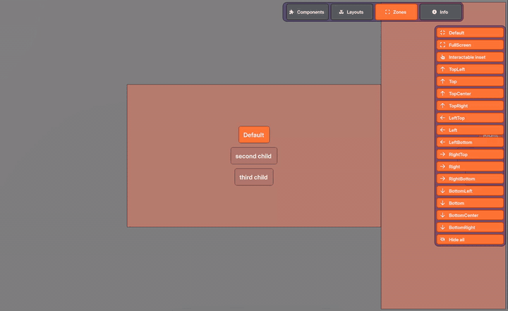

**Minimum usage**

```tsx
<Zone
 type = {ZoneType.Top} // any ZoneType.* (Top, TopLeft, BottomRight, Default, FullScreen, …)
>
 <Text value="Score: 0" />
</Zone>
```

<details>
<summary><b>Full shorthand usage</b></summary>

```tsx
<Zone
 {...fullKitShorthands}
 type            = {ZoneType.Top} // any ZoneType.* (Top, TopLeft, BottomRight, Default, FullScreen, …)
 canBeHidden     = {false}
 startHidden     = {false}
 showCloseButton = {false}
 closeButtonId   = "close-hud"
 showFrom        = "top"          // 'top' | 'bottom' | 'left' | 'right'
 hideTo          = "top"          // 'top' | 'bottom' | 'left' | 'right'
/>
```

</details>

---

### ZoneRoot

Root container used to place content within a zone.


**Minimum usage**

```tsx
<ZoneRoot>
 <Text value="Centered content" />
</ZoneRoot>
```

<details>
<summary><b>Full shorthand usage</b></summary>

```tsx
<ZoneRoot
 {...fullKitShorthands}
/>
```

</details>

<sub>[↑ Back to contents](#contents)</sub>

---

## Columns and rows

Rows and columns lay children out in a line; `cols` sizes a child as a share of a 12-column grid by default (on its own, or per platform with `colsDesktop` / `colsMobile`).

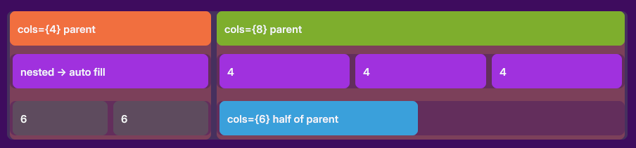

### Row

Arranges children horizontally, with optional spacing and wrapping.

**Minimum usage**

```tsx
<Row>
 <Text value="Left" />
 <Text value="Right" />
</Row>
```

<details>
<summary><b>Full shorthand usage</b></summary>

```tsx
<Row
 {...fullKitShorthands}
 spacing  = {12}
 flexWrap = "wrap" // 'wrap' | 'nowrap' | 'wrap-reverse'
>
 <Text value="Left" />
 <Text value="Right" />
</Row>
```

</details>

---

### RowReverse

Arranges children horizontally in reverse order.

**Minimum usage**

```tsx
<RowReverse>
 <Text value="Left" />
 <Text value="Right" />
</RowReverse>
```

<details>
<summary><b>Full shorthand usage</b></summary>

```tsx
<RowReverse
 {...fullKitShorthands}
 spacing  = {12}
 flexWrap = "wrap" // 'wrap' | 'nowrap' | 'wrap-reverse'
>
 <Text value="Left" />
 <Text value="Right" />
</RowReverse>
```

</details>

---

### Column

Arranges children vertically, with optional spacing and grid sizing.

**Minimum usage**

```tsx
<Column>
 <Text value="First" />
 <Text value="Second" />
</Column>
```

<details>
<summary><b>Full shorthand usage</b></summary>

```tsx
<Column
 {...fullKitShorthands}
 cols        = {12} // 1–12 (theme column count) | 'auto'
 colsDesktop = {8}  // 1–12 (theme column count) | 'auto'
 colsMobile  = {12} // 1–12 (theme column count) | 'auto'
 spacing     = {8}
/>
```

</details>

---

### ColumnReverse

Arranges children vertically in reverse order.

**Minimum usage**

```tsx
<ColumnReverse>
 <Text value="First" />
 <Text value="Second" />
</ColumnReverse>
```

<details>
<summary><b>Full shorthand usage</b></summary>

```tsx
<ColumnReverse
 {...fullKitShorthands}
 cols        = {12} // 1–12 (theme column count) | 'auto'
 colsDesktop = {8}  // 1–12 (theme column count) | 'auto'
 colsMobile  = {12} // 1–12 (theme column count) | 'auto'
 spacing     = {8}
/>
```

</details>

---

### Grid

Arranges children into equally sized cells across rows or columns.

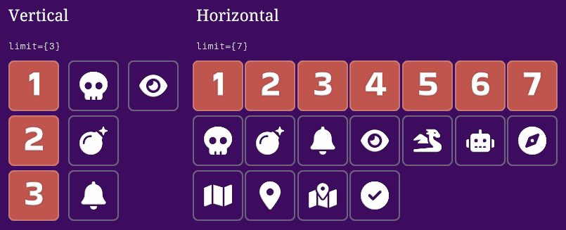

**Minimum usage**

```tsx
<Grid
 limit = {3}
>
 <Label value="A" />
 <Label value="B" />
 <Label value="C" />
</Grid>
```

<details>
<summary><b>Full shorthand usage</b></summary>

```tsx
<Grid
 {...fullKitShorthands}
 limit         = {3}
 direction     = "horizontal" // 'horizontal' | 'vertical'
 padIncomplete = {true}
 spacing       = {8}
 cols          = {12}         // 1–12 (theme column count) | 'auto'
 colsDesktop   = {8}          // 1–12 (theme column count) | 'auto'
 colsMobile    = {12}         // 1–12 (theme column count) | 'auto'
>
 <Label value="A" />
 <Label value="B" />
 <Label value="C" />
</Grid>
```

</details>

<sub>[↑ Back to contents](#contents)</sub>

---

## Backgrounds and dividers

### Background

Panel background and border chrome, usually rendered beside the panel content.

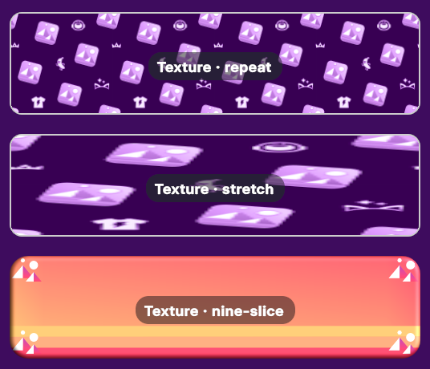

**Minimum usage**

```tsx
<Background />
```

<details>
<summary><b>Full shorthand usage</b></summary>

```tsx
<Background
 {...fullKitShorthands}
 textureSrc = "assets/images/panel.png"
 fitContent = {false} // true = size to children instead of filling the parent (rare; normally leave false)
/>
```

</details>

---

### BackgroundGradient

Gradient panel chrome with a selectable direction.

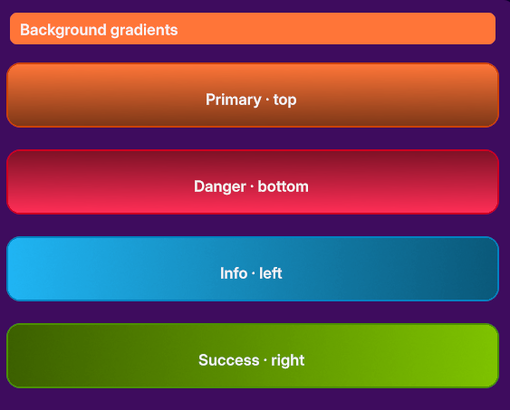

**Minimum usage**

```tsx
<BackgroundGradient />
```

<details>
<summary><b>Full shorthand usage</b></summary>

```tsx
<BackgroundGradient
 {...fullKitShorthands}
 direction     = "top"   // 'top' | 'bottom' | 'left' | 'right'
 gradientStart = {0.25}  // 0–1: where to start sampling the gradient texture (0 = black end, 1 = white end). Default 0.5
 gradientEnd   = {1}     // 0–1: where to stop sampling; must be greater than gradientStart. Default 1
 textureSrc    = "assets/images/gradient.png"
 fitContent    = {false} // true = size to children instead of filling the parent (rare; normally leave false)
/>
```

</details>

---

### Divider

Thin horizontal rule for separating content.

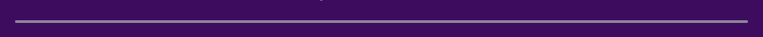

**Minimum usage**

```tsx
<Divider />
```

<details>
<summary><b>Full shorthand usage</b></summary>

```tsx
<Divider
 {...fullKitShorthands}
 backgroundColor = {Color4.create(1, 1, 1, 0.5)}
 margin          = {{ top: 8, right: 0, bottom: 8, left: 0 }}
 thickness       = {2}
 width           = "100%"
/>
```

</details>

<sub>[↑ Back to contents](#contents)</sub>

---

## Typography

Every text component accepts a custom font through `fontSrc`: the scene-relative path to a `.ttf` file inside your scene (e.g. `assets/fonts/Display.ttf`). Only `.ttf` works (OTF / WOFF are rejected), and it needs `@dcl/sdk` ≥ 7.31. Always set a built-in `font` alongside it as a fallback. On Unity Desktop, custom fonts only appear once the scene's assets are optimised (`npm run start:bundles`, or **Compress Assets** in Creator Hub). Details: [docs/components.md](docs/components.md#custom-fonts-fontsrc).

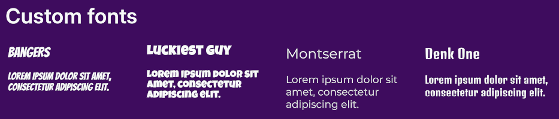

### H1 – H6

Theme-styled headings, from `H1` (largest) down to `H6` (smallest). All six take exactly the same props; the level only changes the theme's default size (40 / 28 / 16 / 14 / 12 / 10 in the default theme).

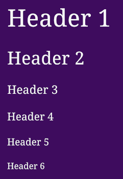

**Minimum usage**

```tsx
<H1 value="Heading 1" />
<H2 value="Heading 2" />
<H3 value="Heading 3" />
<H4 value="Heading 4" />
<H5 value="Heading 5" />
<H6 value="Heading 6" />
```

<details>
<summary><b>Full shorthand usage</b> (same for H1 – H6)</summary>

```tsx
<H2
 {...fullKitShorthands}
 {...fullTextShorthands}
 value     = "Heading"
 fontColor = {Color4.White()}
 fontSize  = {32}                       // optional: overrides the theme size for this level
 font      = "serif"                    // 'sans-serif' | 'serif' | 'monospace'
 fontSrc   = "assets/fonts/Display.ttf"
 textAlign = "middle-left"              // 'top-left' | 'top-center' | 'top-right' | 'middle-left' | 'middle-center' | 'middle-right' | 'bottom-left' | 'bottom-center' | 'bottom-right'
 textWrap  = "nowrap"                   // 'wrap' | 'nowrap'
/>
```

</details>

---

### SectionHeader

Styled heading for a section within a panel.


**Minimum usage**

```tsx
<SectionHeader value="Audio" />
```

<details>
<summary><b>Full shorthand usage</b></summary>

```tsx
<SectionHeader
 {...fullKitShorthands}
 {...fullTextShorthands}
 value     = "Audio"
 fontColor = {Color4.White()}
 fontSize  = {22}
 font      = "sans-serif"  // 'sans-serif' | 'serif' | 'monospace'
 fontSrc   = "assets/fonts/Display.ttf"
 textAlign = "middle-left" // 'top-left' | 'top-center' | 'top-right' | 'middle-left' | 'middle-center' | 'middle-right' | 'bottom-left' | 'bottom-center' | 'bottom-right'
 textWrap  = "nowrap"      // 'wrap' | 'nowrap'
/>
```

</details>

---

### Text

Displays body text with theme-aware typography and text shorthands.

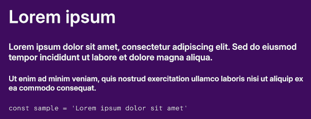

*Text and Code share this image.*

**Minimum usage**

```tsx
<Text value="Hello, world!" />
```

<details>
<summary><b>Full shorthand usage</b></summary>

```tsx
<Text
 {...fullKitShorthands}
 {...fullTextShorthands}
 value     = "Hello, world!"
 fontColor = {Color4.White()}
 fontSize  = {18}
 font      = "sans-serif"  // 'sans-serif' | 'serif' | 'monospace'
 fontSrc   = "assets/fonts/Display.ttf"
 textAlign = "middle-left" // 'top-left' | 'top-center' | 'top-right' | 'middle-left' | 'middle-center' | 'middle-right' | 'bottom-left' | 'bottom-center' | 'bottom-right'
 textWrap  = "wrap"        // 'wrap' | 'nowrap'
/>
```

</details>

---

### Code

Displays text using the theme's monospace style.

**Minimum usage**

```tsx
<Code value="score = 42" />
```

<details>
<summary><b>Full shorthand usage</b></summary>

```tsx
<Code
 {...fullKitShorthands}
 {...fullTextShorthands}
 value     = "score = 42"
 fontColor = {Color4.White()}
 fontSize  = {16}
 font      = "monospace"   // 'sans-serif' | 'serif' | 'monospace'
 fontSrc   = "assets/fonts/Mono.ttf"
 textAlign = "middle-left" // 'top-left' | 'top-center' | 'top-right' | 'middle-left' | 'middle-center' | 'middle-right' | 'bottom-left' | 'bottom-center' | 'bottom-right'
 textWrap  = "nowrap"      // 'wrap' | 'nowrap'
/>
```

</details>

---

### Label

Compact text chip or callout with optional fill and styling.

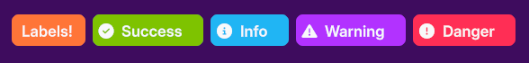

**Minimum usage**

```tsx
<Label value="Ready" />
```

<details>
<summary><b>Full shorthand usage</b></summary>

```tsx
<Label
 {...fullKitShorthands}
 {...fullTextShorthands}
 value       = "Ready"
 fontColor   = {Color4.White()}
 fontSize    = {18}
 font        = "sans-serif"    // 'sans-serif' | 'serif' | 'monospace'
 fontSrc     = "assets/fonts/Display.ttf"
 textAlign   = "middle-center" // 'top-left' | 'top-center' | 'top-right' | 'middle-left' | 'middle-center' | 'middle-right' | 'bottom-left' | 'bottom-center' | 'bottom-right'
 textWrap    = "nowrap"        // 'wrap' | 'nowrap'
 cols        = {6}             // 1–12 (theme column count) | 'auto'
 colsDesktop = {4}             // 1–12 (theme column count) | 'auto'
 colsMobile  = {12}            // 1–12 (theme column count) | 'auto'
/>
```

</details>

<sub>[↑ Back to contents](#contents)</sub>

---

## Buttons and controls

### ButtonText

Clickable text button with theme styling and an optional texture.

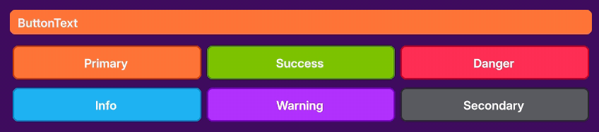

**Minimum usage**

```tsx
<ButtonText
 id        = "start"
 textLabel = "Start"
/>
```

<details>
<summary><b>Full shorthand usage</b></summary>

```tsx
<ButtonText
 {...fullKitShorthands}
 {...fullTextShorthands}
 id              = "start"
 textLabel       = "Start"
 callback        = {() => startGame()}
 cols            = {6}             // 1–12 (theme column count) | 'auto'
 colsDesktop     = {4}             // 1–12 (theme column count) | 'auto'
 colsMobile      = {12}            // 1–12 (theme column count) | 'auto'
 width           = {240}
 height          = {64}
 backgroundColor = {Color4.create(0.2, 0.5, 0.9, 1)}
 textureSrc      = "assets/images/button.png"
 fontColor       = {Color4.White()}
 fontSize        = {20}
 font            = "sans-serif"    // 'sans-serif' | 'serif' | 'monospace'
 fontSrc         = "assets/fonts/Display.ttf"
 textAlign       = "middle-center" // 'top-left' | 'top-center' | 'top-right' | 'middle-left' | 'middle-center' | 'middle-right' | 'bottom-left' | 'bottom-center' | 'bottom-right'
 textWrap        = "nowrap"        // 'wrap' | 'nowrap'
/>
```

</details>

---

### ButtonImage

Clickable image button that can use a texture atlas for its visual states.


> **Your own button art:** see [Custom textures](docs/custom-textures.md) for declaring an atlas and the bundled `atlasBtnIcons*` layouts.

**Minimum usage**

```tsx
<ButtonImage
 id       = "help"
 uvColumn = {1}
/>
```

<details>
<summary><b>Full shorthand usage</b></summary>

```tsx
<ButtonImage
 {...fullKitShorthands}
 id            = "help"
 callback      = {() => helpLayer.show()}
 atlas         = {atlasBtnIconsStyled}
 uvColumn      = {1}
 uvColumnCount = {3}
 uvRowCount    = {3}
 textureSlices = {{
  top   : 0.25,
  right : 0.25,
  bottom: 0.25,
  left  : 0.25,
 }}
 textureSrc    = "assets/images/buttons.png"
/>
```

</details>

---

### ButtonImageClose

Image-based close button, commonly used by a hideable layer.

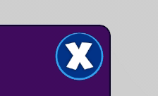

> **Your own button art:** see [Custom textures](docs/custom-textures.md).

**Minimum usage**

```tsx
<ButtonImageClose
 id       = "close"
 callback = {() => layer.hide()}
/>
```

<details>
<summary><b>Full shorthand usage</b></summary>

```tsx
<ButtonImageClose
 {...fullKitShorthands}
 id            = "close"
 callback      = {() => layer.hide()}
 atlas         = {atlasBtnIconsStyled}
 uvColumn      = {1}
 uvColumnCount = {3}
 uvRowCount    = {3}
 textureSlices = {{
  top   : 0.25,
  right : 0.25,
  bottom: 0.25,
  left  : 0.25,
 }}
 textureSrc    = "assets/images/buttons.png"
/>
```

</details>

---

### Toggle

Boolean switch control with an animated track and thumb.

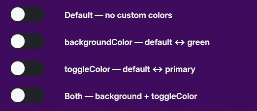

**Minimum usage**

```tsx
<Toggle
 id = "music"
/>
```

<details>
<summary><b>Full shorthand usage</b></summary>

```tsx
<Toggle
 {...fullKitShorthands}
 id              = "music"
 value           = {true}
 defaultValue    = {false}
 backgroundColor = {Color4.create(0.1, 0.1, 0.1, 1)}
 toggleColor     = {Color4.White()}
 height          = {32}
 lerpDuration    = {0.2}
 onChange        = {(enabled) => setMusicEnabled(enabled)}
/>
```

</details>

<sub>[↑ Back to contents](#contents)</sub>

---

## Icons

### Icon

Displays a texture or atlas icon, with optional tinting.

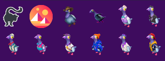

> **Your own icons:** declare a `TextureAtlas`, name the cells, then pass `uvs={myAtlas.uv.<name>}`. Walkthrough: [Example: custom icon sheet](docs/custom-textures.md#example-custom-icon-sheet).

**Minimum usage**

```tsx
<Icon
 src = {myIconsAtlas.source}
 uvs = {myIconsAtlas.uv.coin}
/>
```

<details>
<summary><b>Full shorthand usage</b></summary>

```tsx
<Icon
 {...fullKitShorthands}
 src         = {myIconsAtlas.source}
 uvs         = {myIconsAtlas.uv.coin}
 iconColor   = {Color4.White()}
 textureMode = "stretch" // 'stretch' | 'nine-slices' | 'center'
 rotate      = {0}
/>
```

</details>

---

### SpriteIcon

Displays and animates frames from a sprite sheet.

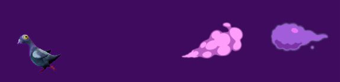

> **Your own sprite sheet:** see [Custom textures](docs/custom-textures.md) for declaring a `TextureAtlas`.

**Minimum usage**

```tsx
<SpriteIcon
 id      = "sparkle"
 src     = "assets/images/sparkle.png"
 columns = {4}
 rows    = {4}
/>
```

<details>
<summary><b>Full shorthand usage</b></summary>

```tsx
<SpriteIcon
 {...fullKitShorthands}
 id           = "sparkle"
 atlas        = {sparkleAtlas}
 src          = "assets/images/sparkle.png"
 columns      = {4}
 rows         = {4}
 fps          = {12}
 offset       = {0}
 limit        = {12}
 pingPong     = {true}
 loopInterval = {0.5}
 playing      = {true}
 looping      = {true}
 iconColor    = {Color4.White()}
 rotate       = {0}
 textureMode  = "stretch" // 'stretch' | 'nine-slices' | 'center'
/>
```

</details>

---

### AvatarIcon

Displays a player's avatar image.

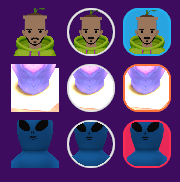

**Minimum usage**

```tsx
<AvatarIcon />
```

<details>
<summary><b>Full shorthand usage</b></summary>

```tsx
<AvatarIcon
 {...fullKitShorthands}
 userId = "0x1234..."
 width  = {64}
 height = {64}
/>
```

</details>

---

### FontAwesome

Displays a Font Awesome Free glyph from the kit's bundled fonts.

For the full list of included icons, see the [Font Awesome Free icon search](https://fontawesome.com/search?ic=free-collection).

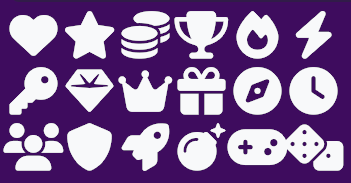


**Minimum usage**

```tsx
<FontAwesome icon="star" />
```

<details>
<summary><b>Full shorthand usage</b></summary>

```tsx
<FontAwesome
 icon      = "star"
 fontSize  = {48}
 fontColor = {Color4.White()}
/>
```

</details>

<sub>[↑ Back to contents](#contents)</sub>

---

### GameIcon

Displays any of the ~4,000 [game-icons.net](https://game-icons.net) icons by name. Same props as `FontAwesome`.

Find names on game-icons.net (the last part of an icon's URL) or search [`gameIcons.icons.ts`](src/ui-component-kit/fonts/gameIcons.icons.ts). The font (`assets/fonts/duck-game-icons.ttf`) is copied into your scene by `copy-assets`. The icons are CC BY 3.0, so credit the authors in your scene. See [docs/game-icons.md](docs/game-icons.md).

**Minimum usage**

```tsx
<GameIcon icon="crossed-swords" />
```

<details>
<summary><b>Full shorthand usage</b></summary>

```tsx
<GameIcon
 icon      = "health-potion"
 fontSize  = {48}
 fontColor = {Color4.Red()}
/>
```

</details>

<sub>[↑ Back to contents](#contents)</sub>

---

## Progress bars

### ProgressBar

Procedural progress bar with configurable fill, background, and border.

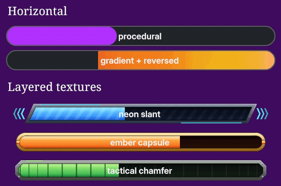

**Minimum usage**

```tsx
<ProgressBar
 id    = "health"
 value = {72}
/>
```

<details>
<summary><b>Full shorthand usage</b></summary>

```tsx
<ProgressBar
 {...fullKitShorthands}
 id              = "health"
 value           = {72}
 minValue        = {0}
 maxValue        = {100}
 fillFrom        = "left" // 'left' | 'right' | 'top' | 'bottom'
 width           = {320}
 height          = {24}
 fillColor       = {Color4.create(0.2, 0.8, 0.3, 1)}
 backgroundColor = {Color4.create(0.1, 0.1, 0.1, 1)}
 borderColor     = {Color4.White()}
 borderWidth     = {2}
 borderRadius    = {12}
 lerpDuration    = {0.2}
/>
```

</details>

---

### ProgressBarImage

Progress bar with image or atlas textures, including optional cropped fill.

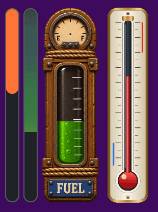

> **Your own bar art or gradient cells:** see [Custom textures](docs/custom-textures.md). Named cells go in `uvCell={myAtlas.named.<name>}`.

**Minimum usage**

```tsx
<ProgressBarImage
 id    = "xp"
 value = {55}
/>
```

<details>
<summary><b>Full shorthand usage</b></summary>

```tsx
<ProgressBarImage
 {...fullKitShorthands}
 id              = "xp"
 value           = {55}
 minValue        = {0}
 maxValue        = {100}
 fillFrom        = "left"       // 'left' | 'right' | 'top' | 'bottom'
 width           = {320}
 height          = {48}
 fillColor       = {Color4.White()}
 backgroundColor = {Color4.create(0.1, 0.1, 0.1, 1)}
 borderColor     = {Color4.White()}
 borderWidth     = {2}
 borderRadius    = {8}
 textures        = {{
  background: "assets/images/track.png",
  fill      : "assets/images/fill.png",
  border    : "assets/images/border.png",
 }}
 atlas           = {atlasGradientColors}
 uvCell          = {atlasGradientColors.named.yellowOrange}
 uvCropWithFill  = {true}
 uvRotate        = {0}          // 0–3 quarter turns
 uvMirror        = {false}
 uvFlip          = {false}
 orientation     = "horizontal" // 'horizontal' | 'vertical'
 textureSlices   = {{ top: 0.25, right: 0.25, bottom: 0.25, left: 0.25 }}
 contentInset    = {{ top: 4, right: 8, bottom: 4, left: 8 }}
 lerpDuration    = {0.2}
/>
```

</details>

---

### ProgressBarRadial

Circular progress indicator rendered from a sprite sheet.

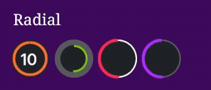

> **Your own ring sprite sheet:** see [Custom textures](docs/custom-textures.md).

**Minimum usage**

```tsx
<ProgressBarRadial
 progress = {0.4}
 width    = {72}
/>
```

<details>
<summary><b>Full shorthand usage</b></summary>

```tsx
<ProgressBarRadial
 {...fullKitShorthands}
 progress        = {0.4}
 width           = {72}
 height          = {72}
 fillColor       = {Color4.White()}
 backgroundColor = {Color4.create(0.1, 0.1, 0.1, 1)}
 borderColor     = {Color4.White()}
 borderWidth     = {2}
 inset           = {4} // 'none' | 'device' | 'interactable'
 mirror          = {false}
 atlas           = {atlasSpritesProgressRadial}
/>
```

</details>

<sub>[↑ Back to contents](#contents)</sub>

---

## Animations

Every animation below, plus combinations and hover / click triggers:

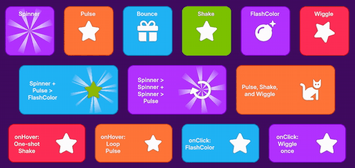

### Bounce

Moves its child up and down.

**Minimum usage**

```tsx
<Bounce
 id = "bounce"
>
 <Label value="Up and down" />
</Bounce>
```

<details>
<summary><b>Full shorthand usage</b></summary>

```tsx
<Bounce
 {...fullKitShorthands}
 id             = "bounce"
 duration       = {0.6}
 burstCount     = {2}
 burstInterval  = {0.5}
 burstOffset    = {0}
 playing        = {true}
 looping        = {true}
 offsetMin      = {-24}
 offsetMax      = {0}
 easingFunction = {easingFunctions.easeOutCubic}
 easingUp       = {easingFunctions.easeOutCubic}
 easingDown     = {easingFunctions.easeOutBounce}
>
 <Label value="Up and down" />
</Bounce>
```

</details>

---

### FlashBorder

Flashes its child's border toward a chosen colour.

**Minimum usage**

```tsx
<FlashBorder
 id = "flash-border"
>
 <Label value="Alert" />
</FlashBorder>
```

<details>
<summary><b>Full shorthand usage</b></summary>

```tsx
<FlashBorder
 {...fullKitShorthands}
 id             = "flashborder"
 duration       = {0.6}
 burstCount     = {2}
 burstInterval  = {0.5}
 burstOffset    = {0}
 playing        = {true}
 looping        = {true}
 flashColor     = {Color4.create(1, 0.2, 0.2, 1)}
 easingFunction = {easingFunctions.easeInOutCubic}
 easingFlash    = {easingFunctions.easeOutCubic}
 easingReturn   = {easingFunctions.easeInCubic}
>
 <Label value="Alert" />
</FlashBorder>
```

</details>

---

### FlashColor

Temporarily shifts its child's tint toward a chosen colour.

**Minimum usage**

```tsx
<FlashColor
 id = "flash-color"
>
 <Label value="Hit" />
</FlashColor>
```

<details>
<summary><b>Full shorthand usage</b></summary>

```tsx
<FlashColor
 {...fullKitShorthands}
 id             = "flashcolor"
 duration       = {0.6}
 burstCount     = {2}
 burstInterval  = {0.5}
 burstOffset    = {0}
 playing        = {true}
 looping        = {true}
 flashColor     = {Color4.create(1, 0.2, 0.2, 1)}
 easingFunction = {easingFunctions.easeInOutCubic}
 easingFlash    = {easingFunctions.easeOutCubic}
 easingReturn   = {easingFunctions.easeInCubic}
>
 <Label value="Hit" />
</FlashColor>
```

</details>

---

### Pulse

Grows and shrinks its child.

**Minimum usage**

```tsx
<Pulse
 id = "pulse"
>
 <Label value="Ready" />
</Pulse>
```

<details>
<summary><b>Full shorthand usage</b></summary>

```tsx
<Pulse
 {...fullKitShorthands}
 id             = "pulse"
 duration       = {0.6}
 burstCount     = {2}
 burstInterval  = {0.5}
 burstOffset    = {0}
 playing        = {true}
 looping        = {true}
 scaleMin       = {0.9}
 scaleMax       = {1.1}
 easingFunction = {easingFunctions.easeInOutCubic}
 easingGrow     = {easingFunctions.easeOutCubic}
 easingShrink   = {easingFunctions.easeInCubic}
>
 <Label value="Ready" />
</Pulse>
```

</details>

---

### Shake

Moves its child from side to side.

**Minimum usage**

```tsx
<Shake
 id = "shake"
>
 <Label value="No" />
</Shake>
```

<details>
<summary><b>Full shorthand usage</b></summary>

```tsx
<Shake
 {...fullKitShorthands}
 id             = "shake"
 duration       = {0.6}
 burstCount     = {2}
 burstInterval  = {0.5}
 burstOffset    = {0}
 playing        = {true}
 looping        = {true}
 count          = {3}
 offsetMin      = {-12}
 offsetMax      = {12}
 easingFunction = {easingFunctions.easeOutCubic}
>
 <Label value="No" />
</Shake>
```

</details>

---

### Spinner

Rotates its child's texture UVs to show activity.

**Minimum usage**

```tsx
<Spinner
 id = "spinner"
>
 <FontAwesome icon="hourglass" />
</Spinner>
```

<details>
<summary><b>Full shorthand usage</b></summary>

```tsx
<Spinner
 {...fullKitShorthands}
 id             = "spinner"
 duration       = {0.6}
 burstCount     = {2}
 burstInterval  = {0.5}
 burstOffset    = {0}
 playing        = {true}
 looping        = {true}
 degrees        = {180}
 easingFunction = {easingFunctions.linear}
>
 <FontAwesome icon="hourglass" />
</Spinner>
```

</details>

---

### Wiggle

Rotates its child's texture UVs back and forth.

**Minimum usage**

```tsx
<Wiggle
 id = "wiggle"
>
 <Icon src={myIconsAtlas.source} uvs={myIconsAtlas.uv.coin} />
</Wiggle>
```

<details>
<summary><b>Full shorthand usage</b></summary>

```tsx
<Wiggle
 {...fullKitShorthands}
 id             = "wiggle"
 duration       = {0.6}
 burstCount     = {2}
 burstInterval  = {0.5}
 burstOffset    = {0}
 playing        = {true}
 looping        = {true}
 count          = {3}
 maxRotation    = {45}
 easingFunction = {easingFunctions.easeInOutCubic}
>
 <Icon src={myIconsAtlas.source} uvs={myIconsAtlas.uv.coin} />
</Wiggle>
```

</details>

<sub>[↑ Back to contents](#contents)</sub>

---

## Notifications

### ToastHostLayer

Layer that displays toast notifications created with the toast helpers.


**Minimum usage**

```tsx
const layers = [toastHostLayer]
```

<details>
<summary><b>Full shorthand usage</b></summary>

```tsx
SetupUiComponentKit({
 layers: [
  ...gameLayers,
  toastHostLayer,
 ],
})
```

</details>

<sub>[↑ Back to contents](#contents)</sub>

---

## Example layouts

Ready-made UI patterns built from the kit's components. This section will grow as more layouts are added.

### Scoreboard / leaderboard

The current list layout demonstrates a scoreboard or leaderboard built from reusable rows and text elements.

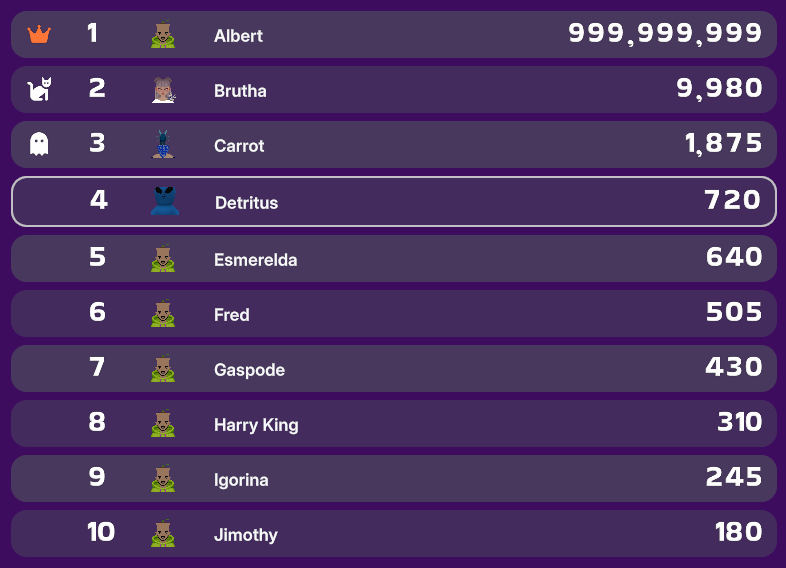

### Game status / round timer

A game HUD layout that combines round status and a timer.


## License & credits

The package is **MIT**. Third-party art is credited separately:

- **[Font Awesome Free](https://fontawesome.com)** — `<FontAwesome icon="…" />` + TTFs under `assets/fonts/` (SIL OFL 1.1; see [docs/licensing.md](docs/licensing.md)). Deprecated PNG subset: `atlasIconsFontAwesome`.
- **[game-icons.net](https://game-icons.net)** — `<GameIcon icon="…" />` + `assets/fonts/duck-game-icons.ttf` (CC BY 3.0 — **credit required** in your scene; see [docs/game-icons.md](docs/game-icons.md)).
- **[CraftPix.net](https://craftpix.net)** — some showcase demo sprite sheets (not npm stock textures).

Full notes: [docs/licensing.md](docs/licensing.md).

## This repo as a demo scene

This GitHub repo is also a runnable Decentraland scene. Local demos live under `src/exampleThemes/` (showcase kitchen-sink). Switch the active bundle in `src/index.ts`.

The **npm package** only ships `src/ui-component-kit`, stock assets, and the CLI — not the example themes.

```bash
npm start
```

## Agent guidance

When creating or changing UI with this kit:

- [`.cursor/skills/ui-component-kit/SKILL.md`](.cursor/skills/ui-component-kit/SKILL.md)
- [`.cursor/rules/ui-component-kit.mdc`](.cursor/rules/ui-component-kit.mdc)
- [`.cursor/rules/relative-imports.mdc`](.cursor/rules/relative-imports.mdc)
- After an install or upgrade: [docs/manual-install.md](docs/manual-install.md) and [docs/upgrade-caveats.md](docs/upgrade-caveats.md)
