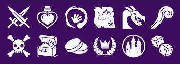

# Game Icons

`<GameIcon />` renders any of the ~4,000 icons from **[game-icons.net](https://game-icons.net)** by name, as a font glyph. It works the same as `<FontAwesome />`: same props, same tinting, same sizing.




```tsx
import { GameIcon, getTheme } from '@stom66/dcl-ui-component-kit'

<GameIcon icon="crossed-swords" />
<GameIcon icon="health-potion" fontSize={64} fontColor={getTheme().colors.danger} />
```

| Option | Type | Description |
|---|---|---|
| `icon` | `GameIconId \| string` | Icon name: kebab-case (`crossed-swords`), camelCase (`crossedSwords`) or `author/name` (`lorc/crossed-swords`) |
| `fontSize` | `number` | Pixel size (defaults to `theme.icons.defaultSize`) |
| `fontColor` | `Color4` | Glyph tint (defaults to theme light) |

Works inside `FlashColor`, `Pulse`, `Spinner` and the other animation wrappers exactly like `FontAwesome`.

---

## Finding icon names

- **Browse:** [game-icons.net](https://game-icons.net). The name is the last part of the icon's URL: `game-icons.net/1x1/lorc/crossed-swords.html` → `crossed-swords`.
- **Search the kit:** every name is listed one per line, with its author, in [`src/ui-component-kit/fonts/gameIcons.icons.ts`](../src/ui-component-kit/fonts/gameIcons.icons.ts) (`GAME_ICON_IDS`). Your editor also autocompletes `icon="…"` from the same list.
- **At runtime:** `resolveGameIcon(name)` returns `{ id, author, glyph, fontSrc, … }` or `undefined`. `gameIconUrl(name)` returns the icon's game-icons.net page.

**Duplicate names.** A few names (about 60, e.g. `fairy`, `shield`) exist for more than one contributor. The bare name goes to Lorc's icon, then Delapouite's. Every other copy is addressed as `author/name`, e.g. `skoll/bat`. `author/name` also works for any icon.

---

## Getting the font into your scene

All icons are in one font, **`assets/fonts/duck-game-icons.ttf`** (~1.7 MB), with its credits file `assets/fonts/LICENSE-game-icons.md`. `copy-assets` copies both into your scene along with the Font Awesome TTFs:

```bash
npx @stom66/dcl-ui-component-kit copy-assets
```

Re-run it after upgrading the kit, because icon codepoints can change between builds. Like every `fontSrc`, glyphs only render once the font is converted to an asset bundle. The current Desktop Explorer does this locally on `npm run start`; use `npm run start:bundles` on older setups. Without bundles you get the built-in font fallback, i.e. empty squares.

---

## Licence and credit (required)

The icons are **CC BY 3.0** (a few contributors CC0). **If your scene shows game icons you must credit the authors**, for example in an in-scene credits panel or your scene description:

> Icons made by Lorc, Delapouite and contributors. Available on https://game-icons.net (CC BY 3.0)

Per-icon authors are in `gameIcons.icons.ts` and `resolveGameIcon(name).author`. The full credit list ships next to the font as `LICENSE-game-icons.md`. See also [licensing.md](./licensing.md).

---

## Updating the icons (maintainers)

The font and name list are generated from the upstream repo [game-icons/icons](https://github.com/game-icons/icons) by `scripts/build-game-icons.py`.

**When was it last built?** The build stamps itself. File modified dates can't be used for this, because git and npm don't preserve them:

- `GAME_ICONS_BUILD` at the top of `src/ui-component-kit/fonts/gameIcons.icons.ts`: `builtAt`, `upstreamCommit`, `upstreamDate`, `iconCount`.
- The showcase **Icons** panel prints the build date and upstream commit under the game icons.

**Rebuild:**

```bash
# 1. Tools (once). skia-pathops is needed for overlap removal — without it Unity
#    can drop some glyphs as tofu (same as the Font Awesome build).
pip install fonttools skia-pathops

# 2. Latest upstream SVGs into the gitignored sources folder
git clone --depth 1 https://github.com/game-icons/icons scripts/game-icons-sources
#    (already cloned? git -C scripts/game-icons-sources pull)

# 3. Build assets/fonts/duck-game-icons.ttf + LICENSE-game-icons.md + gameIcons.icons.ts
npm run build-game-icons
```

Then:

1. Check the output line: icon count, font size, and **`removeOverlaps=yes`**. If it says `NO`, install `skia-pathops` and rebuild before publishing.
2. Run the showcase scene and open **Components → Icons**: the game icons and the colour row should render (no empty squares).
3. Commit `assets/fonts/duck-game-icons.ttf`, `assets/fonts/LICENSE-game-icons.md` and `src/ui-component-kit/fonts/gameIcons.icons.ts` together.
4. Add a line to [upgrade-caveats.md](./upgrade-caveats.md) if names were removed or renamed upstream (scenes using them will log `GameIcon: unknown icon`), and remind consumers to re-run `copy-assets`. New icons shift codepoints, so the scene's font copy must match the installed kit.

**Build options:** `--only a,b,c` builds a small pilot set. It overwrites the outputs, so run a full build afterwards.

**What the script does:** drops each SVG's black background square, flips the white icon path into font coordinates (1024 upem), converts curves to TrueType quadratics, makes outer contours clockwise, removes overlaps (skia-pathops), writes core tables only, and adds one visible ASCII glyph (`.`). That last one is required: the Explorer's asset-bundle converter pre-fills each font's atlas from ASCII and **refuses a font that draws none of those characters**. A refused font gets no bundle, so every icon silently falls back to the built-in font and renders as tofu. The script checks this, and the converter's size and point limits, before saving. The `badges/` folder upstream is a separate template set and is skipped. Codepoints start at U+E000; the BMP Private Use Area holds 6,400, so there's room for about 2,200 more icons before the script needs to move to plane 15.
